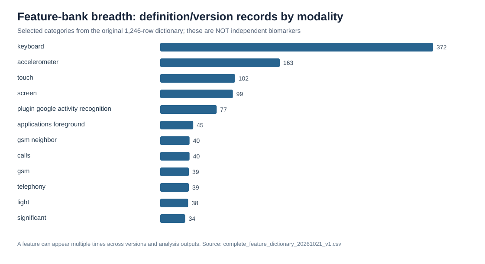
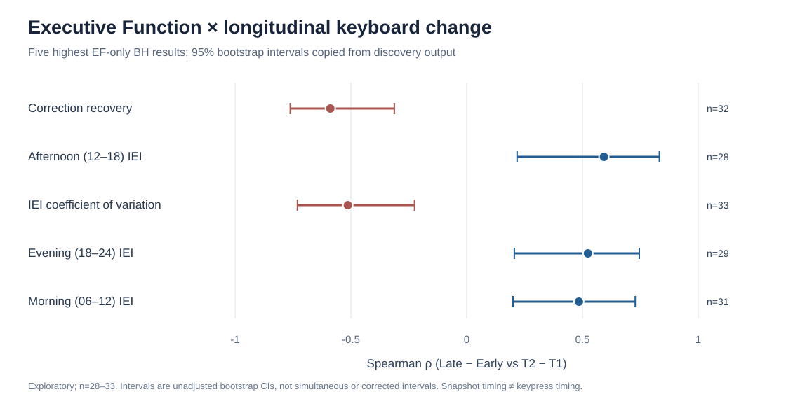
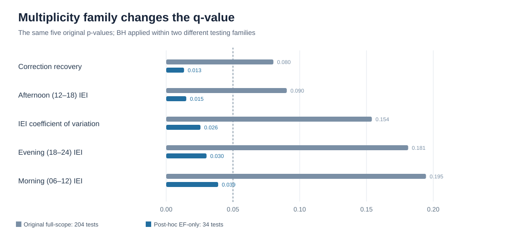

# Passive Smartphone Digital Phenotyping of Cognition
## Research Program: From Data Infrastructure to Candidate Digital Biomarkers

**Comprehensive research report — Expanded Draft v0.2**  
**Evidence snapshot:** 10 November 2026 | **Audience:** research supporters, scientific investigators, future manuscript collaborators  
**Status:** Working expanded research report, with new source-locked catalogs and three figures. All results described as exploratory unless specifically qualified. The bibliography-to-feature history is **pending principal-researcher approval**.  
**Repository:** `shluku/neurotrax_cavia` | **Working specification:** `DONOR_RESEARCH_REPORT_MASTER_BRIEF.md`

> **Purpose of this draft.** Document what the project has actually accomplished, why the work matters, how the analytical strategy evolved, what the strongest results are, how the team challenged them, and what additional evidence is necessary for manuscripts and clinical use. This is the first integrated narrative, not the final manuscript and not a claim that a diagnostic instrument already exists.

---

# Executive Summary

Could ordinary smartphone use reveal changes in cognition without asking an older adult to complete a dedicated test? This research program approached that question using passively collected smartphone events linked to standardized **NeuroTrax** cognitive assessments. The starting point was not a ready-made clinical biomarker; it was a large, technically heterogeneous archive containing typing-related text-state records, touch and screen events, foreground applications, communication/connectivity data, activity labels, and raw motion signals. The project developed the engineering, statistical, and methodological infrastructure needed to discover and critically evaluate possible behavioral measures.

The scope of the work is unusually broad for an early proof of concept (POC). It includes source-table and device mapping, cognitive-score harmonization, privacy-aware feature extraction, alternate temporal windows, a large versioned feature inventory, repeated model benchmarking, unsupervised phenotyping, a focused keyboard deep dive, selective linguistic reconstruction, repeated sensitivity analyses, technical-confounder investigations, and synchronized cross-table sensor pilots. The historical catalog currently contains **1,246 feature-definition/version records covering 496 exact names** and **2,560 saved feature–cognition estimates**; these figures represent documentation and exploratory work, **not** 496 independent biomarkers or 2,560 independent hypotheses.

The clearest group of exploratory cognitive associations comes from the longitudinal keyboard analysis. Of **34 keyboard features** screened against six cognitive outcomes at T1 and longitudinal change, five longitudinal features met **BH-FDR q<0.05 when the complete 34-test Executive Function (EF) domain was evaluated separately**: correction-recovery time, inter-event interval coefficient of variation, and morning, afternoon, and evening median snapshot intervals. Sample sizes were only **28–33**. The EF-domain correction was a **post-hoc, domain-specific** analysis; the original longitudinal discovery family comprised **204 tests**, and none of these features passed q<0.05 in that original full-scope screen. The leading afternoon interval finding weakened after fuller adjustment for acquisition-related factors. This distinction is material to the evidence and is retained in the report.

The study also demonstrated why rigorous validation is integral to discovery. A promising baseline vocabulary-diversity association with Verbal cognition did not persist after fuller demographic/coverage adjustment; exploratory Ridge and Elastic Net models did not demonstrate reliable held-out clinical prediction; some clustering structure changed dramatically after technical residualization; and motion–touch interaction features, though technically measurable, could not be established as longitudinally reliable with the available overlapping recordings.

**Current conclusion:** The project has produced a substantial, reproducible research platform and a focused list of scientifically testable digital phenotyping hypotheses. It has **not yet validated** a dementia diagnostic test or a dependable predictor of cognitive decline. The next phase is to freeze feature definitions, strengthen measurement reliability, establish a defensible feature–literature map, and confirm selected hypotheses in a larger independent cohort.

---

# 1. Clinical Question, Cohort and Study Design

## 1.1 Scientific question and intended clinical value

Neuropsychological testing provides valuable standardized snapshots of cognition, but usually occurs at relatively sparse intervals. A well-validated passive digital biomarker might eventually complement such assessments by adding repeated measurements from daily life. The present project tested the feasibility of that premise, with an emphasis on **interpretable behavior and within-person change**, rather than early claims of automated diagnosis.

The research questions evolved from a broad feasibility question — can a patient-level digital phenotype be built from passive smartphone observations? — to more specific hypotheses about temporal regularity, interruption/recovery, lexical behavior, app-context interactions and physical phone movement.

## 1.2 Cohort and cognitive outcomes

The historical cognitive master contains **83 unique subject identifiers**. Approximately **81** have a usable baseline Global T1 measure, and the paired T1/T2 cohort used for several longitudinal pipelines contains approximately **61** participants; exact denominators vary by assessment, eligibility rules and sensor coverage. NeuroTrax domains analyzed in the project include **Global Cognition, Memory, Executive Function, Attention, Processing Speed, Motor and Verbal**, with additional IQ-related fields in some outputs.

The number of patients available to a specific correlation can be far smaller than the total cohort. For example, the five leading EF keyboard tests used **n=28–33**. The final report must reconcile the cohort flow from the versioned cognitive master, not treat headline enrollment as the analyzed sample.

**Primary source pointers:** `output/cognitive_master/`; `manuscript/study_protocol.md`; `README_PROJECT_HANDOFF.md` (cohort and history sections).

## 1.3 Observational time windows and inference boundary

The project assessed several windows: early 24-hour samples, first-valid observations, 7- and 10-day periods, patient-specific midpoint-split phases, full T1–T2 intervals, and later calendar-thirds sensitivity analyses. One central longitudinal design used:

- **Early:** `[T1, midpoint(T1,T2))`
- **Late:** `[midpoint(T1,T2), T2)`
- **Feature change:** Late − Early
- **Cognitive change:** NeuroTrax T2 − T1

Both digital windows are mainly **after T1**. Accordingly, a correlation between digital change and cognitive change is an overlapping-period association, **not a prospective forecast based on pre-assessment data**. For T1-only cases, some pipelines used a documented midpoint fallback, which requires separate eligibility treatment.

**Key design limitation:** The collection is naturalistic. Phone models, applications, user behavior, missingness and software logging affect which events become observable.

---

# 2. Research Infrastructure and Data Engineering

## 2.1 From raw SensorDB to analyzable patient windows

The project inventoried and extracted from a MySQL-based SensorDB using mapped device identifiers and local time in **Asia/Jerusalem**. Investigated sources included keyboard text-state snapshots, touch, screen, foreground applications, aware logging, communication/message metadata, telephony/GSM, connectivity, locations, Bluetooth/Wi-Fi, Google activity recognition and motion sensors such as accelerometer.

The research pipeline had to solve problems beyond fitting a statistical model:

1. Map patient IDs to potentially changing device IDs without assuming one device equals one person.
2. Define strict timestamp windows while preserving exposure time and observation gaps.
3. Extract data in bounded batches/checkpoints, minimizing expensive raw-table queries.
4. Preserve the difference between **not recorded**, **recorded zero**, **ineligible** and **unknown**.
5. Produce privacy-safe aggregate features without carrying message contents or unnecessary identifiers into research outputs.
6. Freeze extraction definitions, statistical analyses and diagnostic outputs in a version-controlled repository.

The resulting codebase includes protocol files, extraction scripts, audit tables, versioned manifests, exploratory notebooks/scripts, Streamlit review pages and a developing manuscript workspace. The Streamlit application is particularly useful for reconstructing the scientific timeline, but every dashboard figure must be linked back to the underlying source output.

## 2.2 Why acquisition coverage became a scientific issue

Passive recording is not a uniform biological assay. Multiple streams were sparsely observed even after longer windows. The historical source review documented calls present in only **6/82** patients in a 7-day pilot and **12/82** in a 30-day window, while Bluetooth remained at **1/82** across the tested windows. These figures describe specific technical pilots and are not a general estimate of phone-use behavior.

For the broader phenotype, extending observation from 24 hours to ten days reduced average missingness only modestly in the T1 subset and hardly changed it at T2. More raw rows did not necessarily increase the number of distinct people with usable observations. The project therefore moved toward **coverage-aware features** and explicit eligibility counts rather than treating missing sensors as lack of activity.

**Sources:** `README_PROJECT_HANDOFF.md` historical inventory rows 04–07 and 13; `output/analysis_candidates/phase7_10day_window/comparison/`.

## 2.3 Motion archive and technical quality

The ACC workstream added raw-signal extraction, frequency-domain exploration (including filtering and Welch PSD), metadata/hardware assessment, sample-gap/duplicate auditing and patient-day aggregation. One completed patient-sequential review covered **59 processed patients, 51 with signal, 773 device-days**, and found substantial timestamp duplication in the candidate raw stream. Those QC findings caution against interpreting raw motion summaries as direct gait, tremor or functional impairment measures.

Later sensor metadata identified different accelerometers and markedly different observed cadences — approximately **5 Hz versus 125 Hz** in an initial two-device comparison. The database stored nominal sensor specifications but not an explicit requested recording frequency. Native-rate jerk therefore cannot be pooled across devices without rate-aware processing and validation.

**Sources:** `output/analysis_candidates/accelerometer_patient_sequential_pipeline/completion_audit/`; `output/analysis_candidates/cross_modal_acc_priority_v2/`.

---

# 3. Feature Development: Broad Screening to Focused Candidates

## 3.1 The feature-selection philosophy

A central achievement was building and repeatedly refining a **feature bank**. Features were motivated by behavioral interpretability, technical availability, measurement stability and published methodological precedent where applicable. The earliest exploration considered many sensors and aggregates; successive audits prioritized a smaller set whose calculation could be explained, reproduced and related to a plausible construct.

A feature could be **implemented**, **technically calculable**, **adequately observed**, **statistically associated**, **repeatable**, or **clinically valid**. These are different levels. A high raw correlation did not automatically justify retention. In particular, acquisition-volume measures were retained as QC/exposure information rather than casually reclassified as cognitive behavior.

The complete feature dictionary records **1,246 feature/version definitions and 496 exact names**, spanning behavioral candidates, engineered transformations, coverage metrics, technical controls and alternative methods. The donor report will use a family-level selection funnel; the full feature-by-feature catalog remains a supplement.

**Primary catalog:** `manuscript/tables/complete_feature_dictionary_20261021_v1.csv`. **Historical association catalog:** `manuscript/tables/complete_feature_cognitive_associations_20261021_v1.csv`.

## 3.2 Feature-family map (initial reconstruction)

| Modality / family | Examples of constructed or investigated features | Key feasibility/selection lesson | Evidence pointer |
|---|---|---|---|
| Screen and touch | screen sessions, activity bursts, inter-touch spacing, counts and variability | Need observable sessions and enough events; recording cadence may masquerade as behavior | `phase1_features/`, `cross_modal_feature_discovery_v3/` |
| Foreground applications | app counts, diversity, transitions, time-of-day use and event-linked recovery | Event transitions can be observed; duration requires defensible repeated foreground state | `phase2_feature_extraction/`, `cross_modal_decision_and_nonacc_v1/` |
| Keyboard | snapshot timing, variability, correction proxies, breaks, circadian measures, lexical reconstruction | Richest domain-specific discovery; proxy semantics and recording changes are major limitations | `keyboard_deep_dive_v1/` |
| Calls and communications | call-frequency metadata, telephony/message activity | Sparse exposure/participation restricts some analyses | `phase3_rd/`, feature dictionary |
| Activity/mobility | activity-recognition event/day summaries, connectivity and location-derived candidates | Activity labels describe sensor context, not validated human function | `plugin_activity_movement_dictionary/` |
| ACC and raw motion | magnitude, variability, bands, spectral power, quality and hardware measures | Duplicate/gap/sampling-rate QC precedes behavioral or clinical interpretation | `accelerometer_patient_sequential_pipeline/`, `phase2_accelerometer_framework/` |
| Cross-table interactions | ACC×Touch windows, app-switch→touch recovery, screen-resume→touch latency | Requires true same-device timestamp overlap; one stream's calendar coverage is insufficient | `cross_modal_event_export_v1/`, `cross_modal_decision_and_nonacc_v1/` |

**Literature approval checkpoint:** The papers listed later in this draft are **candidate supporting studies already recorded in project literature files**. Their exact historical assignment to each feature awaits principal-researcher approval. We will not assume a paper was used solely because it appears in a later reference list.

---

# 4. Keyboard Deep Dive: Detailed Methods and Feature History

## 4.1 Why the keyboard emerged as a leading measurement domain

Keyboard observations were relatively rich and allowed repeated quantitative features. The canonical expanded keyboard study contained **34 features** derived from text-state snapshot logs and **141 endpoint windows** (81 T1-associated and 60 T2-associated windows). It evaluated timing, activity volume, interruptions, variability, corrections, session fragmentation, time-of-day patterns and change between clinical-interval halves.

The raw table stores **text states and timestamps**, not true key-down/key-up events. Therefore:
- `inter-event interval` = time between **observed snapshots**, not physical key flight time;
- correction recovery = a proxy inferred from changed text states, not directly timed error correction;
- word completion = reconstruction of partial text sequences, not an independently recorded word-level keypress stream.

These distinctions directly influence clinical interpretation.

## 4.2 Keyboard feature catalog — preliminary high-priority subset

| Family | Feature / measure | Operational idea | Longitudinal interpretation / caveat |
|---|---|---|---|
| Central spacing | Median snapshot inter-event interval (IEI) | Median timestamp difference between eligible successive keyboard records | Change may reflect behavior, sampling cadence, app mix or text-change size |
| Circadian spacing | 06–12, 12–18, 18–24 median IEI | Same metric restricted to local-time bands | Circadian comparison requires comparable observation counts and context |
| Relative variability | IEI coefficient of variation (CV) | SD(intervals) / mean(intervals) | Irregular timing; sensitive to long gaps and event cadence |
| Dispersion | IEI IQR and other quantiles | Distributional spread, less dependent on mean than CV | Not synonymous with mean/median slowing |
| Correction/recovery | Median correction-recovery time | Elapsed observed snapshot time around inferred text-edit/correction events | No direct keypress evidence; detection/continuity assumptions matter |
| Pauses/bursts | Long-gap frequency and bounded activity bursts | Thresholded intervals and session segmentation | Threshold and recording gaps can create artificial interruptions |
| Exposure | Active days, observed snapshots, valid interval counts | Measurement of available observation opportunities | Primarily acquisition/engagement covariates, not direct cognitive markers |
| Word timing | Estimated completion duration and variability | Infer progression of text fragments to delimiters | Word length, autocomplete/paste, language and snapshot continuity can bias |
| Length-aware timing | Word-length bins and residual timing variability | Compare completions among similar reconstructed lengths | Few reliable word tokens at T2; length adjustment does not fix absent keypresses |
| Lexical diversity | TTR, MATTR-50/100, MTLD, repetition | Use reconstructed word tokens without persisting raw text | Token count, language and app composition can dominate estimates |

The final appendix will expand this table to **every keyboard feature/version** in the bank, with formulas, code paths, article assignment and decision history.

**Source:** `KEYBOARD_DEEP_DIVE_PROTOCOL.md`; `output/analysis_candidates/keyboard_deep_dive_v1/keyboard_deep_dive_feature_dictionary.csv`; `word_length_adjusted_completion_v1/`; `lexical_feature_feasibility_v1/`.

## 4.3 Original keyboard screening design

The original discovery evaluated **34 features × six cognitive outcomes × two analysis scopes = 408 tests**. BH-FDR was applied within each full **204-test** scope (T1 and longitudinal). Longitudinal tests related feature change to NeuroTrax change, usually with **n≈28–33** for leading candidates.

The leading six longitudinal signals reached the analysis-specified exploratory threshold of **q≤0.20** and had bootstrap intervals excluding zero, but **none passed q<0.05 in the original 204-test discovery scope**. Additional adjusted, restricted-cohort and selected-signal tests were conducted later and must not be represented as independent replication.

## 4.4 Principal keyboard–Executive Function associations

| Feature change versus EF change | n | Spearman ρ | Original p | Full 204-test q | EF-only 34-test q |
|---|---:|---:|---:|---:|---:|
| Correction-recovery time | 32 | −0.589 | 0.000394 | 0.0803 | **0.0134** |
| Afternoon 12–18 median IEI | 28 | +0.593 | 0.000885 | 0.0903 | **0.0151** |
| IEI CV | 33 | −0.513 | 0.002265 | 0.1540 | **0.0257** |
| Evening 18–24 median IEI | 29 | +0.524 | 0.003554 | 0.1813 | **0.0302** |
| Morning 06–12 median IEI | 31 | +0.485 | 0.005723 | 0.1946 | **0.0389** |

All five crossed q<0.05 in a **complete, post-hoc Executive Function–only family of 34 original features**. This is a valid calculation within that restricted family, but it **does not account for choosing EF after observing the wider six-domain screen**. The original full-scope FDR remains the discovery reference.

The signs imply **two potentially different processes**: increasing interruption/irregularity correlated with less favorable EF change, whereas increasing typical recorded IEI correlated with more favorable EF change. These are not logically identical constructs; however, an interpretation based on “faster/slower typing” would be misleading because snapshot cadence and app/device behavior were not controlled by the raw feature alone.

Another selected longitudinal association linked **afternoon IEI change and Attention change** (ρ≈+0.513, n=28, original p≈0.00528, q≈0.195). It is supportive of further questioning, not an independent clinical confirmation.

**Sources:** `output/analysis_candidates/keyboard_deep_dive_v1/signal_discovery/signal_feature_associations.csv`; `output/analysis_candidates/keyboard_ef_only_fdr_v1/ef_only_fdr_all_34_tests.csv`.

## 4.5 What technical and statistical validation revealed

The most prominent afternoon IEI × EF estimate was **ρ=+0.593 (n=28)** in discovery. After recorded demographic/coverage adjustment it was **partial ρ≈+0.508 (p≈0.022)**; with a fuller technical adjustment addressing sampling, package and device factors it declined to **partial ρ≈+0.356 (p≈0.113)**. In that cohort **22 of 28 participants changed their observed device set**, and interval change was related to recording exposure and event-density change.

Similarly, the correction-recovery association weakened under additional recording adjustment and disappeared in a corrected calendar-thirds sensitivity analysis. The corrected first/last-third analysis retained only **19** participants with at least seven active days in both thirds; approximately **270 estimable tests** yielded **no FDR-significant results** (minimum q≈0.836). These analyses do not prove the original effect is absent, but they constrain any claim that it is stable across reasonable measurement definitions.

The dedicated multiplicity audit **reproduced the original BH q-values numerically** and found no invalid tests or duplicate hypotheses in the original 204-test family. A 1,000-permutation full-screen maxT calibration produced adjusted p≈0.341 (correction recovery), 0.323 (afternoon IEI) and 0.694 (IEI CV), providing no full-screen confirmatory signal.

**Sources:** `output/analysis_candidates/statistical_multiplicity_audit_v1/`; `output/analysis_candidates/keyboard_deep_dive_v1/thirds_sensitivity/`; `README_PROJECT_HANDOFF.md`.

## 4.6 Word completion and lexical extension

An earlier word-completion proxy showed a negative nominal association with **Attention T1** (**n=60, ρ≈−0.354, p≈0.00545**); a corresponding FDR q was not saved for this historical association. A newer word-timing reconstruction examined length-related and timing-variability metrics, but sequence continuity and ambiguous text transitions required additional QC.

The lexical feasibility work proposed word-level diversity measures such as **MATTR** and **MTLD**. The reconstructed, high-confidence tokens were much more abundant at T1 than T2, leaving too few patients with adequate token counts at **both** periods for a robust longitudinal lexical comparison. A T1-only analysis was therefore attempted as a separate exploratory study.

The **MATTR-100** analysis initially produced a strong adjusted nominal association with **Verbal T1** (n≈22, p≈0.00274, q≈0.027 in a selected adjusted family). A fuller demographic/coverage adjustment reduced this to **ρ≈0.180, p≈0.422**. The **Motor T1** association remained nominally positive after adjustment (**ρ≈0.539, p≈0.0117; n≈21**), with stable leave-one-out direction, but the high-token group was highly selected by recording volume; language differences were also related to the measure. These findings remain hypotheses, not validated lexical biomarkers.

**Sources:** `output/analysis_candidates/keyboard_deep_dive_v1/lexical_t1_cross_sectional_v1/`; `lexical_t1_cross_sectional_v2_other_domains/`; `mattr100_validation_audit_20261021/`.

---

# 5. Other Analyses and What They Contributed

## 5.1 Baseline and longitudinal modeling

A major line of work built supervised models (principally **Ridge** and **Elastic Net**, with additional alternative model families) to estimate NeuroTrax scores from multiple smartphone features. The proper benchmark is the **mean of the training outcome within each cross-validation fold**, not zero error or an arbitrary comparator.

The strongest larger-cohort corrected historical model example reported **Processing Speed T1, n=71: Ridge RMSE 12.950 versus mean-baseline RMSE 13.718**, with cross-validated R²≈+0.080 versus −0.028. However, the patient-bootstrap interval for the RMSE advantage included zero. A **Motor T1** model (n=79) showed RMSE **10.186 versus 10.678**, also with an uncertainty interval spanning no improvement. Some selected 10-patient models showed larger relative gains but were too small and outcome-selected for reliable generalization.

A separate retrospective audit corrected misalignment between saved predictions and observed outcomes in some historical pooled metric summaries. The corrected model evidence was preserved rather than selecting favorable older summary values.

**Consequence:** The prediction work provides a well-tested baseline framework and negative/qualified evidence, **not** a deployable cognitive scoring model.

**Sources:** `manuscript/prediction_results_audit_20261026.md`; `output/analysis_candidates/phase4_10day_t1_baseline/`; `README_PROJECT_HANDOFF.md`.

## 5.2 Unsupervised structure, PCA and clustering

The project tested whether meaningful phenotypic groups could emerge without cognitive labels. One principal digital feature panel contained **41 active features and 76 eligible patients**; PC1+PC2 described approximately **59%** of standardized feature variance, and a two-cluster solution separated higher and lower recorded interaction activity (approximately **11 versus 65** patients).

However, technical exposure normalization and residualization changed the clustering substantially: one technical-residualized comparison yielded an **adjusted Rand index ≈0.010** against the original reference solution. This implies the initial grouping was heavily sensitive to acquisition/engagement patterns, rather than evidence of robust cognitive subtypes.

The combined digital-plus-ACC PCA and targeted domain projections further explored feature geometry and cognitive overlays; their outcome-informed feature selection, small paired samples and follow-up-sensitive comparisons prevent claims of independent predictive validation.

**Sources:** `output/analysis_candidates/unsupervised_phenotyping_median_span/`; `output/analysis_candidates/full_model_pca/`.

## 5.3 Cross-table and motion-interaction research

A later engineering branch investigated **genuinely cross-table features** rather than single-table counts. It synchronized keyboard, touch, screen, foreground-app and ACC events by patient, device and timestamp, supported by bounded read-only extraction and privacy-preserving Parquet partitions.

A pilot verified **60 screen-unlocked sessions in two patients** with high event-level matching for touch, foreground apps and keyboard snapshots. Later ACC pilots produced synchronized short segments, but sensor cadence varied dramatically. An **ACC × Touch** event-centered test included **251 touch events over seven usable sessions from two patients**: the median central event-minus-control contrast was approximately **+0.008**, with a session-bootstrap 95% CI from **−0.127 to +0.046**. Negative-control and cross-rate analyses did not establish a stable touch-specific motion signal.

Subsequent feasibility audits located **69 30-second candidate windows**, of which **52** passed ACC QC, but only a few sessions supported meaningful within-session coupling. Repeated days were insufficient for robust reliability estimation. Thus ACC-based interaction biomarkers were **deferred for coverage and device-rate reasons**, not deemed biologically absent.

Non-ACC event linking was more promising technically: a selected pilot recorded **137 foreground-app transitions**, with **110 subsequent observed touch events** across **five patients and nine patient-device days**. Candidate measures include screen-resume-to-interaction latency and app-switch-to-interaction recovery, each subject to event censoring and completeness. These were **feasibility candidates**, not yet established cognitive associations.

**Sources:** `output/analysis_candidates/cross_modal_feature_discovery_v2/`; `cross_modal_acc_touch_validation_v1/`; `cross_modal_coverage_bottleneck_v1/`; `cross_modal_continuous_interaction_v1/`; `cross_modal_decision_and_nonacc_v1/`.

---

# 6. Published Research and Feature Rationale — Approval Worksheet

The local repository contains a cross-modal literature register and a lexical-method literature review. Their bibliographic and scientific claims still require direct source verification and **lead-researcher approval for assignment to historical feature selection**. The following is **not yet a finalized provenance statement**.

| Existing literature record | Reported method / relevance | Proposed feature mapping to review | Approval |
|---|---|---|---|
| Ning et al., CHI 2023, DOI: [10.1145/3544548.3580906](https://doi.org/10.1145/3544548.3580906) | Keyboard dynamics with contemporaneous accelerometer/movement context | ACC × keyboard, motion/circadian context | **Pending researcher confirmation** |
| Keijzer et al., ABOARD, DOI: [10.1002/alz.086452](https://doi.org/10.1002/alz.086452) | Repeated passive keyboard measures and reliability in cognitive groups | Keyboard timing/precision concepts and test–retest windows | **Pending researcher confirmation** |
| Multimodal older-adult sensing, DOI: [10.1093/geroni/igag007](https://doi.org/10.1093/geroni/igag007) | Broad passive phone modalities and feature feasibility | Cross-modality feature framework; coverage | **Pending researcher confirmation** |
| Butler et al., *Nature Medicine*, DOI: [10.1038/s41591-024-03475-9](https://doi.org/10.1038/s41591-024-03475-9) | Large-scale multimodal smartphone/watch cognition study | Study feasibility and multimodal rationale | **Pending researcher confirmation** |
| Covington & McFall (2010), DOI: [10.1080/09296171003643098](https://doi.org/10.1080/09296171003643098) | Moving-average type–token ratio (MATTR) | Lexical diversity construction | **Pending researcher confirmation** |
| McCarthy & Jarvis (2010), DOI: [10.3758/BRM.42.2.381](https://doi.org/10.3758/BRM.42.2.381) | MTLD lexical diversity methodology | MTLD / length sensitivity | **Pending researcher confirmation** |
| Vizer et al., DOI: [10.3389/fdgth.2020.567158](https://doi.org/10.3389/fdgth.2020.567158) | Natural-language and touchscreen typing in MCI comparisons | Lexical/snapshot behavior hypotheses | **Pending researcher confirmation** |
| Kampman et al., DOI: [10.1177/20552173221139584](https://doi.org/10.1177/20552173221139584) | Longitudinal smartphone keystroke dynamics in MS | Keyboard timing construct, cross-disease limitations | **Pending researcher confirmation** |

**Documentation rule:** The principal researcher decides which publications genuinely formed the selection rationale. Once approved, the final report cites them simply as supporting literature for their assigned features. We will **not** use “found after the fact” language; nor will we claim an unapproved paper as an established source. Even when a paper is approved, the wording must accurately distinguish direct reproduction from adapted or conceptually inspired measures.

**Internal sources:** `output/analysis_candidates/cross_modal_feature_discovery_v1/CROSS_MODAL_LITERATURE_REGISTER.md`; `output/analysis_candidates/keyboard_deep_dive_v1/lexical_feature_feasibility_v1/literature_review_20261021_v1.csv`; `manuscript/references.md`.

---

# 7. Evidence Hierarchy and What “Significant” Means Here

We retain four separate levels of evidence:

**Level 1 — Operational feasibility.** The data can be extracted, patient/device linked and analyzed by defined rules; adequate coverage is reported.

**Level 2 — Exploratory association.** A specified feature is associated with a cognitive score or change in the available cohort, with effect size and relevant multiplicity adjustment reported.

**Level 3 — Robust, independently replicated association.** The feature is measurement-valid, repeatable, appropriately adjusted and reproduces on a genuinely independent cohort with a frozen analysis plan.

**Level 4 — Clinical usefulness.** The measure adds meaningful information beyond existing practice, offers appropriate discrimination/calibration or longitudinal value, and has a documented intended use.

**The current project robustly demonstrates Level 1 for several streams and reports Level 2 signals. It has not established Levels 3–4.**

The original keyboard discovery's BH-FDR calculation was independently reconstructed to numerical precision. For the leading three EF correlations, full-scope 1,000-permutation maxT **FWER-adjusted p-values** were approximately **0.341, 0.323 and 0.694**. These results should not be conflated with within-EF BH q-values; they control a different error criterion across a broader search.

The number of independent participants matters more than the number of raw records or sensor events. For plausible true correlations around |ρ|≈0.35, the existing confirmatory design scenarios estimated on the order of **82–105 usable independent participants** for three prespecified hypotheses at 80–90% power under their assumptions, suggesting a practical usable cohort target around **100–120**, subject to coverage and recruitment calculations. This is a planning scenario, not proof that the existing estimates equal the future population effect.

**Sources:** `output/analysis_candidates/statistical_multiplicity_audit_v1/`; `keyboard_ef_only_fdr_v1/`.

---

# 8. Findings We Would Retain, Qualify or Defer

| Workstream | What is established | Current scientific decision |
|---|---|---|
| Core patient-level data pipeline | Reproducible extraction, mapping, time windows, feature dictionary and QC | **Retain as major deliverable** |
| Keyboard EF timing and irregularity | Several substantial nominal correlations; five EF-specific BH q<0.05; full-scope and technical sensitivity concerns | **Priority hypotheses, not validated biomarkers** |
| Word completion and lexical diversity | Some nominal T1 associations; T2 token and sequence-continuity problems | **Retain as exploratory secondary line; improve measurement** |
| Baseline score prediction | Extensive benchmarking; no dependable verified out-of-sample gain | **Report negative/limited predictive evidence transparently** |
| PCA/cluster phenotyping | Rich low-dimensional structure; marked exposure dependence | **Descriptive methodological result, not clinical subtype** |
| ACC/jerk motion interaction | Timestamp synchronization and feature feasibility, but unstable and sparse repeated sampling | **Defer clinical inference; retain engineering protocols** |
| App-switch and screen-resume features | Event-level feasibility and basic latency proxies | **Candidate methods for repeated-day validation** |

The scientific story is **convergence through scrutiny**, not merely a list of positive and negative p-values. Many investigated directions were useful because they revealed limits of observation, measurement assumptions or generalizability. Those lessons inform the next experimental design.

---

# 9. Roadmap: Turning the POC into Manuscripts

The research program is likely to support more than one scientific output, but journal scope and authorship will need team agreement. A reasonable structure is:

**Manuscript A — Measurement and feasibility / data methods.** Patient/device linkage, timestamp QC, missingness, feature definitions, privacy-safe extraction, window sensitivity and technical failure modes. The already completed engineering work is substantive even without clinical validation.

**Manuscript B — Exploratory longitudinal keyboard signals.** Reproducible keyboard definitions, EF associations, full multiplicity handling, technically adjusted sensitivities, correction-recovery and variability hypotheses, and a clearly framed independent-confirmation plan.

**Manuscript C — Cross-modal and lexical extensions (conditional).** Only if the repeatability/coverage and linguistic reconstruction problems are resolved or if the article is explicitly a methods/feasibility study. These pathways should not be presented as confirmed cognitive biomarkers now.

## 9.1 Analyses needed before strong claims

1. **Cohort flow and representativeness:** exact subjects, devices, exclusions and observed days by feature and time window.
2. **Individual feature methods:** fully versioned formulas, event semantics, thresholds, timestamp joins and any proxy assumptions.
3. **Literature provenance approval:** feature-to-paper map verified against actual publications and signed off by the lead researcher.
4. **Measurement validity:** single-character text-transition analysis; word-length/continuity QC; app/device/cadence effects; repeated-day ICC/other reliability measures where justified.
5. **Sensitivity and influence:** common-patient windows, robust effect-size intervals, LOO, distributional plots, outlier diagnostics and technical exposure adjustments.
6. **Statistical family freeze:** limited hypotheses, one clear target outcome per confirmatory question, proper adjusted inference and a preplanned analysis strategy.
7. **Independent data:** additional usable patients, repeated measures or separate data source, power/precision and missing-data plan.
8. **Prediction only if warranted:** truly pre-assessment inputs, nested preprocessing/tuning and independent held-out validation against mean/clinical baselines.
9. **Clinical interpretation:** clinically meaningful EF decline thresholds, uncertainty, subgroup robustness, use-case feasibility and ethical governance.

## 9.2 New figures and tables to develop

| Proposed exhibit | Scientific purpose | Status |
|---|---|---|
| Figure 1: Cohort and device/feature eligibility flow | Explain denominator shrinkage, missingness and device mappings | **Needs new standardized audit figure** |
| Figure 2: Research timeline / feature-selection funnel | Show progression from broad candidates to focused hypotheses | **Needs chronology and feature decision reconstruction** |
| Figure 3: Multimodal architecture and temporal windows | Clarify SensorDB, early/late and event joins | **Can draft from documented design** |
| Figure 4: Keyboard extraction illustration (text states → proxies) | Show what IEI/recovery/word timing truly mean | **Needs precise algorithm review** |
| Figure 5: EF association forest (original and adjusted estimates, n, q and CIs) | Present primary exploratory evidence without cherry-picking | **Partially available; needs harmonized figure** |
| Figure 6: Within-person feature distributions versus ΔEF | Make effect sizes, outliers and sample selection visible | **Needs patient-level QC and sensitivity** |
| Figure 7: Stability across windows/devices/apps | Show technical robustness or failure clearly | **Some saved audits; needs synthesis** |
| Figure 8: Prediction versus fold-local mean, with uncertainty | Establish forecasting limits | **Saved metrics available; verify comparable folds** |
| Figure 9: PCA before/after coverage residualization | Reveal influence of technical exposure | **Saved source outputs available** |
| Figure 10: ACC×Touch synchronization and coverage funnel | Document cross-table feasibility | **Saved descriptive plots/tables; assemble** |
| Table 1: Cohort and assessment characteristics | Baseline clinical description | **Requires final data permission and audit** |
| Table 2: Feature bank and paper-to-feature matrix | Bibliographic/methodological provenance | **Requires researcher approval** |
| Table 3: Final original keyboard screen and EF sensitivity | Full statistical context with correct q family | **Saved results available** |
| Table 4: Validation and negative-result matrix | Transparent scientific learning | **Needs consolidation** |

The next iterations should add **new calculations and plots where they answer a prespecified scientific question**. Any reanalysis must be tagged as newly calculated rather than silently replacing historical findings.

---

# 10. Immediate Next Decisions

The next work session should establish a source-locked inventory with one report paragraph → one or more traceable source files. Then prioritize (a) the full keyboard deep-dive catalog, (b) the original literature history confirmation and (c) a single harmonized evidence table. Only after these are stable should we design new inferential calculations.

The work already completed is substantial. Its current value lies not only in several promising associations but also in **knowing exactly why other findings did not withstand technical or statistical scrutiny**. A credible scientific program must report both.

---

## V0.2 update summary

This update adds a detailed source-based keyboard extraction contract, a feature bank development history and dictionary inventory, a 34-feature EF audit table, a 42-row Deep Dive catalog, a seven-row lexical extension catalog, three reproducible visualizations, a literature identity correction and a targeted principal-researcher approval checklist. The statistical results in these additions are copied from saved historical outputs, not newly tested hypotheses.

---

# Part II — Source-Locked Methods and Evidence Expansion

The following sections expand the initial report with source-locked feature methods, technical validation, historical workstreams, and reproducible figures. The term *validation* is used narrowly: test–retest, technical sensitivity and computational reproduction are not substitutes for independent clinical validation.

## 11. Reconstruction of the research program

The project contains a **40-workstream chronology** covering cognitive data harmonization, device mapping, initial feature-bank experiments, window design, supervised benchmarking, unsupervised phenotyping, motion processing, keyboard deep dives and cross-modal sensor pilots. This is an inventory of *substantive analysis streams*, not 40 independent studies.

| Development stage | What was built or tested | What the work established |
|---|---|---|
| Cognitive/data integration | NeuroTrax T1/T2 master tables, device crosswalk, source inventories and bounded SQL extraction | Patient-linked analysis was technically possible, but available data differed widely by modality |
| Initial phenotype discovery | Screen, touch, apps, calls, communications and motion candidate features; 24-hour, 7-day and 10-day observation windows | A broad feature bank could be constructed; sparsity and changing observation windows were major constraints |
| Early/late longitudinal design | Midpoint split, per-patient T1–T2 change, full-interval and calendar-thirds sensitivity | Feature changes could be related to cognitive changes, but longitudinal recording was uneven |
| Predictive modeling | Ridge, Elastic Net, alternate supervised models, fold-local mean comparisons, domain models | Broad feature sets did not yet produce dependable generalizable clinical predictions |
| Unsupervised phenotype | PCA, K-means, technical normalization, cluster sensitivity | Interpretable phone-interaction structure existed but was strongly affected by recording exposure |
| Raw motion and cross-table engineering | ACC signal QC, duplicate/gap checks, rate analysis, synchronized screen/touch/app/keyboard events | Cross-stream alignment and short-window features could be built; sufficient repeated valid observations remained scarce |
| Keyboard Deep Dive | Canonical snapshot representation, 42 dictionary rows, 34 screened features, corrections and circadian metrics | A small set of candidate longitudinal Executive Function associations emerged |
| Word-level and lexical extension | Reconstructed completions, word-length QC, MATTR/MTLD and T1-only lexical tests | Strict continuity and token-coverage gates sharply reduced the effective sample |

The archived complete dictionary contains **1,246 definition/version rows** and **496 distinct names**. Multiple rows often refer to versions, alternative time windows, transformations or technical/QC features. The project also has **2,560 saved association estimates**; repeated analyses of the same patients and variants must not be counted as independent studies.

**Figure 1. Scope of the feature development program.** Counts are *versioned dictionary records*, not clinical biomarkers or independent hypotheses. The figure is generated directly from `manuscript/tables/complete_feature_dictionary_20261021_v1.csv`.

**Full historical source table:** [Forty workstreams with original scripts and output pointers](tables/research_history_40_workstreams_v0_2.csv).

## 12. Measurement, linkage and sample eligibility

### 12.1 Data provenance and denominators

Five denominators must be separated: subjects with cognitive records; subjects with linked device identifiers; those with raw logs in the specified interval; those meeting feature-quality thresholds; and those with a matched cognitive endpoint. Missingness cannot be inferred from the total number of SQL records, and an individual may be eligible for one modality but not another.

All time windows in the analyzed code use local Asia/Jerusalem calendar interpretation. Midpoint Early and Late windows are half-open; changing them alters the scientific estimand. The principal keyboard longitudinal comparisons associate **Late–Early feature differences** with **T2–T1 cognition differences**, mostly using observations collected after the baseline assessment. They are therefore contemporaneous longitudinal associations, not fully prospective baseline-only predictions.

A rigorous final cohort flowchart must reconcile exact sample sizes by endpoint and observation gate. The historical numbers — 83 cognitive identifiers, about 81 with baseline cognition, about 61 paired assessments and n=28–33 in the five leading keyboard tests — are not interchangeable.

### 12.2 Acquisition exposure as part of the phenotype

Recording quality is not a nuisance to discard after feature calculation; it is part of the data-generating process. Extracted QC fields include raw rows, canonical records after deduplication, active days and minutes, eligible intervals, parse failures, number of devices and number of application packages. Longer collection windows did not reliably overcome sparse modalities. Device changes, app mixtures and event rates can correlate with apparently behavioral measures.

For ethical reporting, no raw text, personal messages, contact identifiers or sensitive patient records are exported into donor tables. Existing code's privacy claims still require a comprehensive release audit and formal ethics/consent verification before a public report.

## 13. Complete keyboard extraction methodology

### 13.1 What the source actually records

The database `keyboard` table contains SQL columns `_id`, `timestamp`, `device_id`, `data`; the JSON payload can include `before_text`, `current_text`, `package_name`, `is_password` and contextual fields. This is a **text-state snapshot stream**. It cannot establish true key-down or key-up time, hold time, flight time, specific physical keys or exact word entry durations.

Canonical events are deduplicated and ordered by device, application package and time. Rows representing password fields are excluded from content inspection. A gap over **30 seconds** ends a typing burst; admissible adjacent time intervals are positive and no more than **30,000 ms**. A long pause can be defined as a gap exceeding **2,000 ms** inside the eligible burst; this is not the same as a measured hesitation between physical keystrokes.

The source code enforces an important invariant: **valid inter-event intervals cannot exceed distinct canonical observations** at the same patient/window level. The saved count audit found zero violations. A historical discrepancy in published independent medians arose because medians were calculated across different nonmissing row sets; this was corrected in the interpretation without silently replacing source results.

**Source:** `KEYBOARD_DEEP_DIVE_PROTOCOL.md`, especially its Source Schema, Privacy and Canonicalization, Count Denominator Audit and Window Definitions.

### 13.2 Representative operational features

For valid consecutive observations in the same device/package stream, the snapshot inter-event interval is **IEI = tᵢ − tᵢ₋₁**, with 0 < IEI ≤ 30,000 milliseconds. The sample coefficient of variation uses **CV = SD(IEI)/mean(IEI)**. A time-of-day median interval is calculated only from eligible intervals assigned to the local time band of the *later* snapshot, for example 06:00–12:00 or 12:00–18:00.

A correction-like event is inferred from a drop in text length relative to the preceding or source state, with recovery derived from later observable positive text growth within the allowed window. This proxy can reflect editing, but it is not a direct measurement of how long a person needed to correct a physical typing error. Autocorrection, multi-character changes, replacement/paste and logging gaps are competing explanations.

Other metrics include IQR, MAD, SD and quantile spread of intervals; long-pause counts/rates; burst count and median duration; session fragmentation; observed deletions; text-growth transitions; word-completion candidates; daily trends and circadian timing.

### 13.3 The 42-row dictionary is not the same as the 34-test discovery family

The canonical source dictionary contains **42** recorded keyboard feature and QC rows. The discovery analysis evaluated **34** of them against six cognitive outcomes separately at baseline and for longitudinal change. Later word-length and lexical branches include **seven** additional named definitions in the original feasibility dictionary; these are not part of the historical 34-feature screen.

Two new source-traceable catalogs now preserve this distinction:

- [Deep Dive dictionary: all 42 entries and discovery inclusion](tables/keyboard_feature_dictionary_42_v0_2.csv)
- [Original EF discovery: all 34 tests, effect sizes, p and both original/focused q-values, bootstrap intervals](tables/keyboard_discovery_complete_34_v0_2.csv)
- [Lexical extension: seven feature definitions](tables/lexical_extension_features_v0_2.csv)

Each record also contains an unresolved literature approval status. Multiple historical definition versions are flagged for direct code review rather than collapsed into an assumed unique formula.

### 13.4 Statistical discovery and the five EF findings

The original keyboard screen comprised **34 × 6 × 2 = 408 associations**, with separate BH correction across the 204 baseline and 204 change tests. Candidate review required n≥20, exploratory q≤0.20, bootstrap sign stability ≥0.80 and a bootstrap percentile interval excluding zero. These rules selected follow-up hypotheses, not clinical confirmation.

Five longitudinal associations met BH-FDR q<0.05 in the **complete 34-hypothesis Executive Function slice** when recalculated post hoc. The same associations did **not** meet q<0.05 under the originally applied 204-test longitudinal BH family. The estimates are presented explicitly below to avoid conflating testing families.

**Figure 2. Exploratory effect sizes.** The error bars are unadjusted percentile bootstrap intervals copied from saved discovery output, not simultaneous or multiplicity-adjusted confidence intervals. Sample sizes range from 28 to 33 subjects.

**Figure 3. Choice of hypothesis family.** These are two ways of adjusting the *same historical p-values*. The selected-domain q-values provide within-EF evidence but do not address the fact that EF was prioritized after viewing six domains.

### 13.5 Reliability and technical sensitivity

Validation here means several different tests, each with its own evidentiary scope:

| Test | Design | Existing result and interpretation |
|---|---|---|
| Leave-one-patient-out | Recompute each association after omitting one subject | Original selected associations retained their sign across LOO runs; this is influence analysis, not independent replication |
| Recording-adjusted ranks | Control for age/sex/education plus relevant coverage and recording factors | Afternoon IEI vs EF: partial ρ≈0.508, p≈0.022 in a narrower adjustment; partial ρ≈0.356, p≈0.113 in a broader technical model |
| Device and app audit | Compare app/package context, interval counts, active days and device-set changes | 22 of 28 participants in the afternoon IEI cohort changed their observed device set; event density and IEI change were related |
| Test–retest | Compare first and last 14 observed recording days where ≥28 observed days exist | Too few balanced observations for many calendar-midpoint tests; T2 reliability generally lower |
| Calendar thirds | First and last calendar thirds, middle excluded, with minimum seven active days per period | Only 19 paired subjects retained; corrected family q-min≈0.836, with no FDR passing result |
| Full-screen multiplicity audit | Reproduce BH and use dependence-aware maxT permutations | Original q-values reproduced; full-screen adjusted maxT p≈0.341, 0.323 and 0.694 for the top three |
| General model integration | Evaluate expanded 34-feature keyboard set against existing bank under shared CV cohorts | Selected improvements were insufficient to outperform fold-local mean consistently; no model promotion |

Importantly, the corrected thirds analysis did **not** itself eliminate a previously robust *adjusted* correction-recovery result: the original adjusted thirds estimate was already near zero. That nuanced history should be preserved in the scientific methods discussion.

### 13.6 Word and lexical extension

An initial observable word-completion run extracted **105,402 candidate completion sequences**, of which **64,667** were tagged high-confidence under that version's permissive criteria. A later stricter sequence-continuity pipeline required adjacent `previous current_text == next before_text`, append-only changes, observed start boundaries and no interruption exceeding 2 seconds, while recording multi-character jumps as ambiguous text increments.

Under the stricter definition, the saved project protocol reports **30,800 reliable T1 completions** and **4,264 T2 completions**. Only **three** paired patients achieved the threshold of 100 reliable tokens in both periods. These counts are **not directly comparable** to the earlier confidence class, which used a different algorithm.

The T1-only lexical pathway allowed exploration of MATTR, MTLD, TTR, word-length and timing variability in a larger available group. The MATTR-100 high-token subset comprised only **22/81** T1 patients; that group differed strongly in exposure. The selected MATTR/Verbal partial association (ρ≈0.607, p≈0.00274) weakened to ρ≈0.180 (p≈0.422) after fuller adjustment. The Motor result remained directionally stable in n≈21, but selection by token availability and language/app composition remains substantial. The lesson is that **measurement validity and who supplies enough text both affect the estimated correlation**.

**Source:** `KEYBOARD_DEEP_DIVE_PROTOCOL.md` sections on Word-Completion, Word-Length, Lexical Feasibility and MATTR-100 Validation.

## 14. Interpreting the modeling and non-keyboard research

### 14.1 Broad predictive models did not outperform a rigorous baseline consistently

Ridge, Elastic Net and other supervised algorithms were trained on multiple time windows and outcome domains. Cross-validation used a **training-fold mean target** as a baseline, which is a stricter and clinically more meaningful standard than reporting a correlation on the same training sample. The full 34-keyboard expanded feature bank improved some head-to-head comparisons against an older bank, but both were generally worse than the mean baseline and all saved R² in that specific integration were negative.

A corrected historical audit also identified problems in some pooled prediction-alignment summaries. This reinforces why we must cite source per-repeat results and a frozen model evaluation specification rather than a selected old leaderboard.

### 14.2 Unsupervised PCA and clustering were strongly acquisition-sensitive

A leading unsupervised phenotype included 41 active digital features and separated 76 eligible people into two recorded-use groups, approximately 11 and 65. Its initial principal components explained substantial standardized feature variance. Yet technical residualization changed the original cluster assignment dramatically (one saved adjusted Rand index ≈0.01). This demonstrates a key discovery of the POC: clusters of logging intensity can look stable under random seeds while remaining sensitive to recording exposure and not defining clinical subtypes.

### 14.3 Sensor fusion was feasible but not yet behaviorally validated

The raw accelerometer workstream established device-level extraction, QC, frequency-domain summaries, quality flags and bounded processing. However, large differences in recording cadence, timestamp duplicates and insufficient synchronized days limit the comparability of raw acceleration or jerk statistics across devices.

Event-based synchronizations of applications, touch and screen were technically promising, whereas ACC×Touch contrast estimates did not support a reliable motion-coupling marker under existing quality and negative-control tests. The engineering platform should be retained; clinical interpretation of these measures should be deferred.

## 15. Literature verification and researcher approval

The previously archived literature review contained a **bibliographic author-label mismatch**. Two distinct ABOARD abstracts both list **Matthijs J. Keijzer as first author**:

- **Keijzer et al. (2023)**, *Passive logging of smartphone interactions as a feasible and reliable measure to monitor everyday cognition in Alzheimer’s Disease*, DOI [10.1002/alz.071350](https://doi.org/10.1002/alz.071350), N=16; the author list also includes James Twose.
- **Keijzer et al. (2024 supplement; first online 2025)**, *Passively collected smartphone behaviour as a reliable and feasible measure for global cognition in Alzheimer’s Disease*, DOI [10.1002/alz.086452](https://doi.org/10.1002/alz.086452), N=40 and 28 days of logging.

The source record's shorthand “Twose et al.” should be corrected for citation purposes; it is not a separate Twose-first-author report under DOI 10.1002/alz.071350. Both ABOARD studies used dedicated keystroke data, whereas the present data are text-state snapshots, so corresponding feature constructs may be **adapted rather than identical**.

Other recorded studies include Ning et al. (2023; DOI 10.1145/3544548.3580906) on combined typing-session and accelerometer context; Covington and McFall (2010) on MATTR; McCarthy and Jarvis (2010) on MTLD and lexical diversity; and the recorded touchscreen/language MCI study (DOI 10.3389/fdgth.2020.567158). Additional bibliographic verification and method comparison are scheduled.

The researcher will decide which papers informed original feature selection and approve each mapping. Once approved, the final report will state the literature basis directly, without artificial “found later” qualifications. Meanwhile, **we will not treat an unapproved historical mapping as established**.

[Researcher literature approval worksheet](tables/literature_feature_approval_queue_v0_2.csv)

## 16. What must be added to produce publication-quality articles?

The next generation of the research should replace broad undirected scanning with explicit, well-measured questions. Initial priorities are:

1. **Freeze the cohort and generate denominators by feature**: exact number of mapped/observed/eligible subjects at each step, with a reproducible cohort flow diagram.
2. **Reconstruct a source-verified literature-to-feature matrix**, including the paper's exact operational metric, our algorithm and the distinction between direct reproduction versus adaptation.
3. **Re-extract strict snapshot transitions where justified**, identifying single-character transitions, package continuity and changes in event generation; compare with the original 34-feature family without replacing historical data.
4. **Quantify repeatability and technical confounding** for the leading timing, CV and recovery features under shared windows and comparable devices/apps.
5. **Report sample-precision and uncertainty** with original-effect CIs, influence diagnostics, effect modification and clearly defined multiplicity families.
6. **Prespecify a focused set of independent confirmatory hypotheses**, with a realistic usable-sample target and power/precision plan; the current cohort is a discovery set.
7. **Run prospective models only with temporally appropriate inputs**, leakage-safe tuning and external validation, compared against both mean and meaningful clinical baselines.
8. **Assemble paper-ready figures**: cohort flow; feature-bank funnel; representative interval extraction diagram; EF effect forest and technical adjustments; patient-level paired distributions with privacy controls; device/coverage heat map; CV comparisons and PCA sensitivity plots.
9. **Verify governance and clinical framing** before donor release: diagnostic composition, consent/approval records, responsible investigator, funding and author contributions.

**The project is now well past a trivial software prototype, but remains a scientific POC.** Its main value is a coherent set of extracted features, versioned source evidence, computational reliability checks, and selected hypotheses that can be tested in an appropriately designed follow-up study.

**Reproducibility note.** All new tables and figures in this expansion are aggregate-only and created from previously saved rows. The accompanying `tools/build_donor_draft_assets_v0_2.py` script performs cataloging and visualization only; it does **not** rerun cognitive tests, generate patient-level exports, or silently change historical p-values.

---

# Appendix A. Key Internal Evidence Index

All paths are relative to the `research_dbeaver` repository. These links refer to versioned source materials and are **not** external scientific references.

- `README_PROJECT_HANDOFF.md` — detailed chronological review, modality/QC history, keyboard and cross-table workstreams.
- `PROJECT_HANDOFF_20261101.md` — latest summarized EF-domain findings and guardrails as of that handoff.
- `manuscript/study_protocol.md`, `manuscript/analysis_decisions.md`, `manuscript/draft_v01.md` — evolving framing and manuscript decisions (not automatically current truth for every later analysis).
- `manuscript/tables/complete_feature_dictionary_20261021_v1.csv` — feature/version provenance and formulas.
- `manuscript/tables/complete_feature_cognitive_associations_20261021_v1.csv` — complete historical saved direct feature–cognition register.
- `output/analysis_candidates/keyboard_deep_dive_v1/signal_discovery/signal_feature_associations.csv` — original 408-test keyboard screen.
- `output/analysis_candidates/keyboard_deep_dive_v1/signal_validation/` — selected signal adjustments, robustness and reliability.
- `output/analysis_candidates/keyboard_ef_only_fdr_v1/` — all 34 EF comparisons and post-hoc within-domain BH.
- `output/analysis_candidates/statistical_multiplicity_audit_v1/` — original BH audit, permutations and future power scenarios.
- `output/analysis_candidates/keyboard_deep_dive_v1/lexical_feature_feasibility_v1/` and `mattr100_validation_audit_20261021/` — lexical methods/coverage.
- `output/analysis_candidates/unsupervised_phenotyping_median_span/` and `full_model_pca/` — unsupervised structure and sensitivity.
- `manuscript/prediction_results_audit_20261026.md` — corrected prediction interpretation.
- `output/analysis_candidates/cross_modal_feature_discovery_v1/`, `cross_modal_acc_touch_validation_v1/`, `cross_modal_continuous_interaction_v1/`, `cross_modal_decision_and_nonacc_v1/` — cross-table literature, feasibility and validation.
- `streamlit_app.py` — dashboard presentation and navigation to research outputs. Confirm underlying file and code version before quoting dashboard figures.

# Appendix B. Open Verification / Approval List

- [ ] Confirm exact enrolled/paired/analysis populations and clinical cohort description (diagnostic composition, exclusions and assessment dates).
- [ ] Verify ethics/consent/funding and permissions for donor-facing material; do not fabricate declarations.
- [ ] Principal researcher approves paper-to-feature history for each retained family.
- [ ] Expand `KEYBOARD_DEEP_DIVE_FEATURE_CATALOG.csv` from original dictionary and all lexical extensions.
- [ ] Cross-check every quoted numerical result against its original source CSV (including time period, eligibility, n, p, q, CI, covariates).
- [ ] Reconcile original vs corrected vs selected-family statistics in one provenance-locked table.
- [ ] Select which scientific output is a first manuscript and freeze its primary question.
- [ ] Review and approve final donor narrative before distribution.

**End of draft v0.2.**
