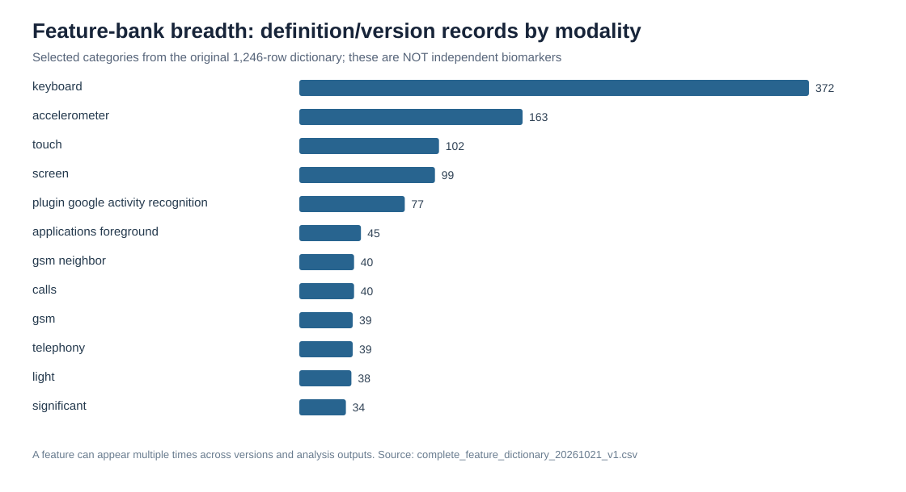
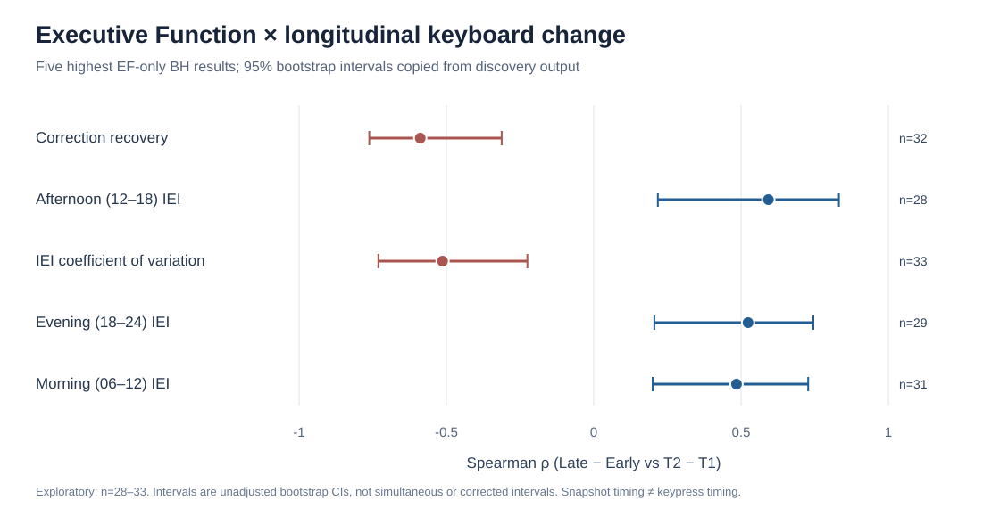
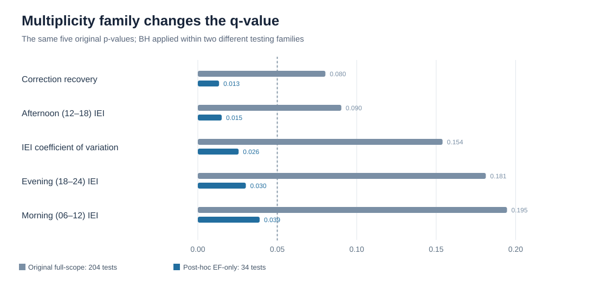

# Extended Methods, Evidence and Development History
## Integrated Part II — Donor Report v0.2

The following sections expand the initial report with source-locked feature methods, technical validation, historical workstreams, and reproducible figures. The term *validation* is used narrowly: test–retest, technical sensitivity and computational reproduction are not substitutes for independent clinical validation.

## 11. Reconstruction of the research program

The project contains a **40-workstream chronology** covering cognitive data harmonization, device mapping, initial feature-bank experiments, window design, supervised benchmarking, unsupervised phenotyping, motion processing, keyboard deep dives and cross-modal sensor pilots. This is an inventory of *substantive analysis streams*, not 40 independent studies.

| Development stage | What was built or tested | What the work established |
|---|---|---|
| Cognitive/data integration | NeuroTrax T1/T2 master tables, device crosswalk, source inventories and bounded SQL extraction | Patient-linked analysis was technically possible, but available data differed widely by modality |
| Initial phenotype discovery | Screen, touch, apps, calls, communications and motion candidate features; 24-hour, 7-day and 10-day observation windows | A broad feature bank could be constructed; sparsity and changing observation windows were major constraints |
| Early/late longitudinal design | Midpoint split, per-patient T1–T2 change, full-interval and calendar-thirds sensitivity | Feature changes could be related to cognitive changes, but longitudinal recording was uneven |
| Predictive modeling | Ridge, Elastic Net, alternate supervised models, fold-local mean comparisons, domain models | Broad feature sets did not yet produce dependable generalizable clinical predictions |
| Unsupervised phenotype | PCA, K-means, technical normalization, cluster sensitivity | Interpretable phone-interaction structure existed but was strongly affected by recording exposure |
| Raw motion and cross-table engineering | ACC signal QC, duplicate/gap checks, rate analysis, synchronized screen/touch/app/keyboard events | Cross-stream alignment and short-window features could be built; sufficient repeated valid observations remained scarce |
| Keyboard Deep Dive | Canonical snapshot representation, 42 dictionary rows, 34 screened features, corrections and circadian metrics | A small set of candidate longitudinal Executive Function associations emerged |
| Word-level and lexical extension | Reconstructed completions, word-length QC, MATTR/MTLD and T1-only lexical tests | Strict continuity and token-coverage gates sharply reduced the effective sample |

The archived complete dictionary contains **1,246 definition/version rows** and **496 distinct names**. Multiple rows often refer to versions, alternative time windows, transformations or technical/QC features. The project also has **2,560 saved association estimates**; repeated analyses of the same patients and variants must not be counted as independent studies.

**Figure 1. Scope of the feature development program.** Counts are *versioned dictionary records*, not clinical biomarkers or independent hypotheses. The figure is generated directly from `manuscript/tables/complete_feature_dictionary_20261021_v1.csv`.

**Full historical source table:** [Forty workstreams with original scripts and output pointers](tables/research_history_40_workstreams_v0_2.csv).

## 12. Measurement, linkage and sample eligibility

### 12.1 Data provenance and denominators

Five denominators must be separated: subjects with cognitive records; subjects with linked device identifiers; those with raw logs in the specified interval; those meeting feature-quality thresholds; and those with a matched cognitive endpoint. Missingness cannot be inferred from the total number of SQL records, and an individual may be eligible for one modality but not another.

All time windows in the analyzed code use local Asia/Jerusalem calendar interpretation. Midpoint Early and Late windows are half-open; changing them alters the scientific estimand. The principal keyboard longitudinal comparisons associate **Late–Early feature differences** with **T2–T1 cognition differences**, mostly using observations collected after the baseline assessment. They are therefore contemporaneous longitudinal associations, not fully prospective baseline-only predictions.

A rigorous final cohort flowchart must reconcile exact sample sizes by endpoint and observation gate. The historical numbers — 83 cognitive identifiers, about 81 with baseline cognition, about 61 paired assessments and n=28–33 in the five leading keyboard tests — are not interchangeable.

### 12.2 Acquisition exposure as part of the phenotype

Recording quality is not a nuisance to discard after feature calculation; it is part of the data-generating process. Extracted QC fields include raw rows, canonical records after deduplication, active days and minutes, eligible intervals, parse failures, number of devices and number of application packages. Longer collection windows did not reliably overcome sparse modalities. Device changes, app mixtures and event rates can correlate with apparently behavioral measures.

For ethical reporting, no raw text, personal messages, contact identifiers or sensitive patient records are exported into donor tables. Existing code's privacy claims still require a comprehensive release audit and formal ethics/consent verification before a public report.

## 13. Complete keyboard extraction methodology

### 13.1 What the source actually records

The database `keyboard` table contains SQL columns `_id`, `timestamp`, `device_id`, `data`; the JSON payload can include `before_text`, `current_text`, `package_name`, `is_password` and contextual fields. This is a **text-state snapshot stream**. It cannot establish true key-down or key-up time, hold time, flight time, specific physical keys or exact word entry durations.

Canonical events are deduplicated and ordered by device, application package and time. Rows representing password fields are excluded from content inspection. A gap over **30 seconds** ends a typing burst; admissible adjacent time intervals are positive and no more than **30,000 ms**. A long pause can be defined as a gap exceeding **2,000 ms** inside the eligible burst; this is not the same as a measured hesitation between physical keystrokes.

The source code enforces an important invariant: **valid inter-event intervals cannot exceed distinct canonical observations** at the same patient/window level. The saved count audit found zero violations. A historical discrepancy in published independent medians arose because medians were calculated across different nonmissing row sets; this was corrected in the interpretation without silently replacing source results.

**Source:** `KEYBOARD_DEEP_DIVE_PROTOCOL.md`, especially its Source Schema, Privacy and Canonicalization, Count Denominator Audit and Window Definitions.

### 13.2 Representative operational features

For valid consecutive observations in the same device/package stream, the snapshot inter-event interval is **IEI = tᵢ − tᵢ₋₁**, with 0 < IEI ≤ 30,000 milliseconds. The sample coefficient of variation uses **CV = SD(IEI)/mean(IEI)**. A time-of-day median interval is calculated only from eligible intervals assigned to the local time band of the *later* snapshot, for example 06:00–12:00 or 12:00–18:00.

A correction-like event is inferred from a drop in text length relative to the preceding or source state, with recovery derived from later observable positive text growth within the allowed window. This proxy can reflect editing, but it is not a direct measurement of how long a person needed to correct a physical typing error. Autocorrection, multi-character changes, replacement/paste and logging gaps are competing explanations.

Other metrics include IQR, MAD, SD and quantile spread of intervals; long-pause counts/rates; burst count and median duration; session fragmentation; observed deletions; text-growth transitions; word-completion candidates; daily trends and circadian timing.

### 13.3 The 42-row dictionary is not the same as the 34-test discovery family

The canonical source dictionary contains **42** recorded keyboard feature and QC rows. The discovery analysis evaluated **34** of them against six cognitive outcomes separately at baseline and for longitudinal change. Later word-length and lexical branches include **seven** additional named definitions in the original feasibility dictionary; these are not part of the historical 34-feature screen.

Two new source-traceable catalogs now preserve this distinction:

- [Deep Dive dictionary: all 42 entries and discovery inclusion](tables/keyboard_feature_dictionary_42_v0_2.csv)
- [Original EF discovery: all 34 tests, effect sizes, p and both original/focused q-values, bootstrap intervals](tables/keyboard_discovery_complete_34_v0_2.csv)
- [Lexical extension: seven feature definitions](tables/lexical_extension_features_v0_2.csv)

Each record also contains an unresolved literature approval status. Multiple historical definition versions are flagged for direct code review rather than collapsed into an assumed unique formula.

### 13.4 Statistical discovery and the five EF findings

The original keyboard screen comprised **34 × 6 × 2 = 408 associations**, with separate BH correction across the 204 baseline and 204 change tests. Candidate review required n≥20, exploratory q≤0.20, bootstrap sign stability ≥0.80 and a bootstrap percentile interval excluding zero. These rules selected follow-up hypotheses, not clinical confirmation.

Five longitudinal associations met BH-FDR q<0.05 in the **complete 34-hypothesis Executive Function slice** when recalculated post hoc. The same associations did **not** meet q<0.05 under the originally applied 204-test longitudinal BH family. The estimates are presented explicitly below to avoid conflating testing families.

**Figure 2. Exploratory effect sizes.** The error bars are unadjusted percentile bootstrap intervals copied from saved discovery output, not simultaneous or multiplicity-adjusted confidence intervals. Sample sizes range from 28 to 33 subjects.

**Figure 3. Choice of hypothesis family.** These are two ways of adjusting the *same historical p-values*. The selected-domain q-values provide within-EF evidence but do not address the fact that EF was prioritized after viewing six domains.

### 13.5 Reliability and technical sensitivity

Validation here means several different tests, each with its own evidentiary scope:

| Test | Design | Existing result and interpretation |
|---|---|---|
| Leave-one-patient-out | Recompute each association after omitting one subject | Original selected associations retained their sign across LOO runs; this is influence analysis, not independent replication |
| Recording-adjusted ranks | Control for age/sex/education plus relevant coverage and recording factors | Afternoon IEI vs EF: partial ρ≈0.508, p≈0.022 in a narrower adjustment; partial ρ≈0.356, p≈0.113 in a broader technical model |
| Device and app audit | Compare app/package context, interval counts, active days and device-set changes | 22 of 28 participants in the afternoon IEI cohort changed their observed device set; event density and IEI change were related |
| Test–retest | Compare first and last 14 observed recording days where ≥28 observed days exist | Too few balanced observations for many calendar-midpoint tests; T2 reliability generally lower |
| Calendar thirds | First and last calendar thirds, middle excluded, with minimum seven active days per period | Only 19 paired subjects retained; corrected family q-min≈0.836, with no FDR passing result |
| Full-screen multiplicity audit | Reproduce BH and use dependence-aware maxT permutations | Original q-values reproduced; full-screen adjusted maxT p≈0.341, 0.323 and 0.694 for the top three |
| General model integration | Evaluate expanded 34-feature keyboard set against existing bank under shared CV cohorts | Selected improvements were insufficient to outperform fold-local mean consistently; no model promotion |

Importantly, the corrected thirds analysis did **not** itself eliminate a previously robust *adjusted* correction-recovery result: the original adjusted thirds estimate was already near zero. That nuanced history should be preserved in the scientific methods discussion.

### 13.6 Word and lexical extension

An initial observable word-completion run extracted **105,402 candidate completion sequences**, of which **64,667** were tagged high-confidence under that version's permissive criteria. A later stricter sequence-continuity pipeline required adjacent `previous current_text == next before_text`, append-only changes, observed start boundaries and no interruption exceeding 2 seconds, while recording multi-character jumps as ambiguous text increments.

Under the stricter definition, the saved project protocol reports **30,800 reliable T1 completions** and **4,264 T2 completions**. Only **three** paired patients achieved the threshold of 100 reliable tokens in both periods. These counts are **not directly comparable** to the earlier confidence class, which used a different algorithm.

The T1-only lexical pathway allowed exploration of MATTR, MTLD, TTR, word-length and timing variability in a larger available group. The MATTR-100 high-token subset comprised only **22/81** T1 patients; that group differed strongly in exposure. The selected MATTR/Verbal partial association (ρ≈0.607, p≈0.00274) weakened to ρ≈0.180 (p≈0.422) after fuller adjustment. The Motor result remained directionally stable in n≈21, but selection by token availability and language/app composition remains substantial. The lesson is that **measurement validity and who supplies enough text both affect the estimated correlation**.

**Source:** `KEYBOARD_DEEP_DIVE_PROTOCOL.md` sections on Word-Completion, Word-Length, Lexical Feasibility and MATTR-100 Validation.

## 14. Interpreting the modeling and non-keyboard research

### 14.1 Broad predictive models did not outperform a rigorous baseline consistently

Ridge, Elastic Net and other supervised algorithms were trained on multiple time windows and outcome domains. Cross-validation used a **training-fold mean target** as a baseline, which is a stricter and clinically more meaningful standard than reporting a correlation on the same training sample. The full 34-keyboard expanded feature bank improved some head-to-head comparisons against an older bank, but both were generally worse than the mean baseline and all saved R² in that specific integration were negative.

A corrected historical audit also identified problems in some pooled prediction-alignment summaries. This reinforces why we must cite source per-repeat results and a frozen model evaluation specification rather than a selected old leaderboard.

### 14.2 Unsupervised PCA and clustering were strongly acquisition-sensitive

A leading unsupervised phenotype included 41 active digital features and separated 76 eligible people into two recorded-use groups, approximately 11 and 65. Its initial principal components explained substantial standardized feature variance. Yet technical residualization changed the original cluster assignment dramatically (one saved adjusted Rand index ≈0.01). This demonstrates a key discovery of the POC: clusters of logging intensity can look stable under random seeds while remaining sensitive to recording exposure and not defining clinical subtypes.

### 14.3 Sensor fusion was feasible but not yet behaviorally validated

The raw accelerometer workstream established device-level extraction, QC, frequency-domain summaries, quality flags and bounded processing. However, large differences in recording cadence, timestamp duplicates and insufficient synchronized days limit the comparability of raw acceleration or jerk statistics across devices.

Event-based synchronizations of applications, touch and screen were technically promising, whereas ACC×Touch contrast estimates did not support a reliable motion-coupling marker under existing quality and negative-control tests. The engineering platform should be retained; clinical interpretation of these measures should be deferred.

## 15. Literature verification and researcher approval

The previously archived literature review contained a **bibliographic author-label mismatch**. Two distinct ABOARD abstracts both list **Matthijs J. Keijzer as first author**:

- **Keijzer et al. (2023)**, *Passive logging of smartphone interactions as a feasible and reliable measure to monitor everyday cognition in Alzheimer’s Disease*, DOI [10.1002/alz.071350](https://doi.org/10.1002/alz.071350), N=16; the author list also includes James Twose.
- **Keijzer et al. (2024 supplement; first online 2025)**, *Passively collected smartphone behaviour as a reliable and feasible measure for global cognition in Alzheimer’s Disease*, DOI [10.1002/alz.086452](https://doi.org/10.1002/alz.086452), N=40 and 28 days of logging.

The source record's shorthand “Twose et al.” should be corrected for citation purposes; it is not a separate Twose-first-author report under DOI 10.1002/alz.071350. Both ABOARD studies used dedicated keystroke data, whereas the present data are text-state snapshots, so corresponding feature constructs may be **adapted rather than identical**.

Other recorded studies include Ning et al. (2023; DOI 10.1145/3544548.3580906) on combined typing-session and accelerometer context; Covington and McFall (2010) on MATTR; McCarthy and Jarvis (2010) on MTLD and lexical diversity; and the recorded touchscreen/language MCI study (DOI 10.3389/fdgth.2020.567158). Additional bibliographic verification and method comparison are scheduled.

The researcher will decide which papers informed original feature selection and approve each mapping. Once approved, the final report will state the literature basis directly, without artificial “found later” qualifications. Meanwhile, **we will not treat an unapproved historical mapping as established**.

[Researcher literature approval worksheet](tables/literature_feature_approval_queue_v0_2.csv)

## 16. What must be added to produce publication-quality articles?

The next generation of the research should replace broad undirected scanning with explicit, well-measured questions. Initial priorities are:

1. **Freeze the cohort and generate denominators by feature**: exact number of mapped/observed/eligible subjects at each step, with a reproducible cohort flow diagram.
2. **Reconstruct a source-verified literature-to-feature matrix**, including the paper's exact operational metric, our algorithm and the distinction between direct reproduction versus adaptation.
3. **Re-extract strict snapshot transitions where justified**, identifying single-character transitions, package continuity and changes in event generation; compare with the original 34-feature family without replacing historical data.
4. **Quantify repeatability and technical confounding** for the leading timing, CV and recovery features under shared windows and comparable devices/apps.
5. **Report sample-precision and uncertainty** with original-effect CIs, influence diagnostics, effect modification and clearly defined multiplicity families.
6. **Prespecify a focused set of independent confirmatory hypotheses**, with a realistic usable-sample target and power/precision plan; the current cohort is a discovery set.
7. **Run prospective models only with temporally appropriate inputs**, leakage-safe tuning and external validation, compared against both mean and meaningful clinical baselines.
8. **Assemble paper-ready figures**: cohort flow; feature-bank funnel; representative interval extraction diagram; EF effect forest and technical adjustments; patient-level paired distributions with privacy controls; device/coverage heat map; CV comparisons and PCA sensitivity plots.
9. **Verify governance and clinical framing** before donor release: diagnostic composition, consent/approval records, responsible investigator, funding and author contributions.

**The project is now well past a trivial software prototype, but remains a scientific POC.** Its main value is a coherent set of extracted features, versioned source evidence, computational reliability checks, and selected hypotheses that can be tested in an appropriately designed follow-up study.

**Reproducibility note.** All new tables and figures in this expansion are aggregate-only and created from previously saved rows. The accompanying `tools/build_donor_draft_assets_v0_2.py` script performs cataloging and visualization only; it does **not** rerun cognitive tests, generate patient-level exports, or silently change historical p-values.
